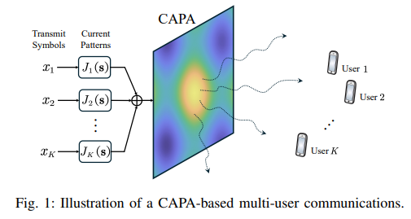
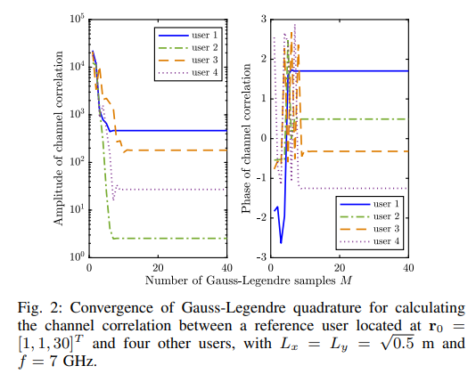
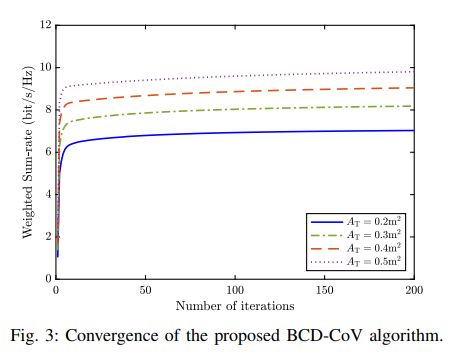
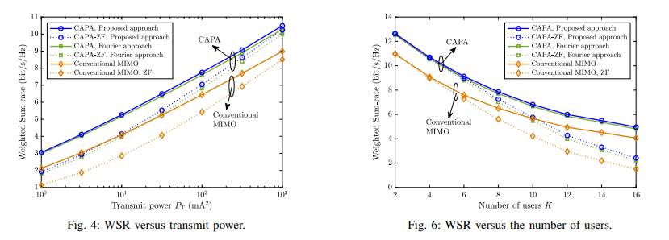
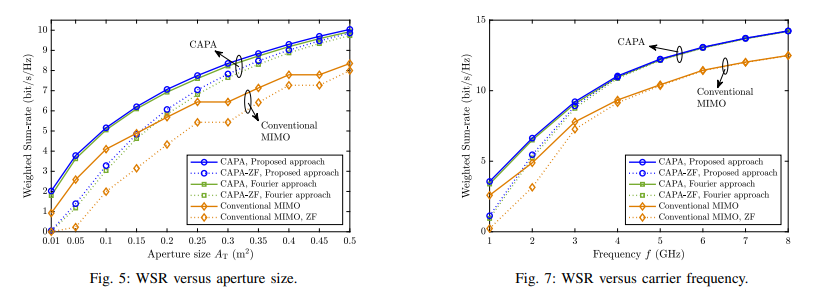
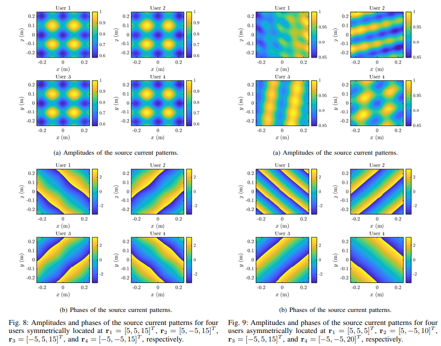

# Continuous Aperture Array (CAPA) Beamforming Optimization: Unlocking a New Paradigm for Ultra-Large Scale Antenna Communications in 6G [with MATLAB Code]

Continuous Aperture Array (CAPA) Beamforming Optimization: Unlocking a New Paradigm for Ultra-Large Scale Antenna Communications in 6G
This paper focuses on the beamforming optimization problem of Continuous Aperture Array (CAPA) multi-user communication systems. Compared to traditional discrete antenna arrays, CAPA can emit electromagnetic waves through continuous source current distribution on the aperture, fully exploiting spatial degrees of freedom. However, this also transforms the beamforming optimization into an non-convex, integral-based functional programming problem, which is difficult for traditional discrete optimization methods to solve efficiently.
For this purpose, the paper proposes two low-complexity solutions:
1  
Variational Method (CoV): Derive the closed-form structure of optimal continuous source distribution, and design an integral iterative algorithm.
2  
Based on the Corr-ZF: relying on channel correlation to obtain closed-loop ZF source current distribution, the original problem is simplified into power allocation and solved using the water injection method.
Numerical results verification: Compared with the mainstream Fourier discrete scheme, the proposed CoV method has better communication performance and reduces the complexity of large aperture/high frequency scenarios by hundreds of times. Corr-ZF can approach the asymptotic optimal performance of CoV, providing an efficient path for the practical application of CAPA.
Since the advent of 3G, MIMO technology has become the core for wireless communication capacity enhancement. The physical limitations of antenna numbers have driven communication towards large-scale MIMO and ultra-large-scale MIMO. New architectures such as holographic MIMO, intelligent metasurfaces, and dynamic metasurface antennas ultimately aim to construct continuous electromagnetic apertures (CAPA).
CAPA has significant advantages compared to traditional discrete MIMO:
★  
Break through the limit of discrete antenna number, fully release space freedom;
★  
The RF port requirements are lower, and the hardware efficiency and scalability are stronger.
Existing CAPA research has mainly focused on the performance analysis of single transceivers, and there is still a shortcoming in multi-user scenario optimization. The current mainstream Fourier discrete method requires increasing the number of basis functions exponentially with aperture and frequency, leading to an explosion in complexity and difficulty in approaching theoretical performance limits.
Based on this, the paper directly addresses the core issue: can direct optimization of continuous source currents break through performance and complexity bottlenecks? It also conducts original research on capacitation beamforming for maximizing multi-user downlink weighted sum rate.
Methodology Introduction This paper proposes two unapproximated, low-complexity continuous domain optimization methods for the generalized optimization problem of CAPA multi-user downlink weighted sum rate maximization, fully addressing the pain points of traditional solutions.
1. Variational Beamforming (CoV) 1  
Problem transformation: By using power equation constraints, quadratic transformation, and Lagrange duality, the original non-convex functional problem is transformed into an unconstrained solvable form;  
2  
Block coordinate descent (BCD) iteration: Alternately optimize the auxiliary variables with the continuous beam:  
★  
Fix the beam, closed-form update the auxiliary parameters;  
★  
Utilize the basic lemma of complex variational method to derive the closed-form structure of optimal continuous source current;  
★  
Transform into channel-related matrix operation, without integral operations throughout, requiring only matrix inverse;  
3  
Advantage: Directly optimize continuous functions without approximation, complexity independent of aperture size and carrier frequency, highlighting its superiority in large scenarios.  
2. Corr-ZF Beamforming 1  
Zero-forcing constraint: Forcefully eliminate user interference, reducing the dimensionality of infinite optimization;  
2  
Closed-form solution design: Relying on the channel correlation matrix inverse, directly obtain the zero-forcing beam without pseudo-inverse, avoiding infinite-dimensional matrix inverse;  
3  
Power allocation: Simplified to classical water-filling method, with complexity only O(K³)+O(K), extremely low overhead;  
4  
Advantage: Closed-form solution, computational simplicity, asymptotically approaching optimal performance under high power/large aperture.  
Comparison with Fourier Method ★  
Fourier method: Requires discrete approximation, number of basis functions grows exponentially with aperture/frequency, complexity O(N_F³), where N_F can reach 10⁴;  
★  
This paper's method: No approximation, complexity determined by the number of users K, hundreds of times faster in large aperture/high frequency scenarios.
Conclusion This paper successfully proposes two CAPA beamforming optimization schemes: the variational method (CoV) and the related zero-forcing (Corr-ZF), achieving the first dual breakthroughs in continuous domain direct optimization and low complexity without approximation.
Experimental evidence:
1  
The CoV method has better performance than the Fourier discrete scheme, and its computational complexity is reduced by hundreds of times in large aperture and high frequency scenarios.
2  
Corr-ZF achieves asymptotic optimality with extremely low complexity, balancing performance and engineering implementation.
3  
CAPA continues to leverage its advantages as the aperture size increases, frequency rises, and user base expands, making it an essential core architecture for 6G ultra-large scale antenna communication.
The proposed variational optimization approach can be extended to cutting-edge scenarios such as tripolar CAPA, dual continuous apertures for transmission and reception, and integrated transduction. It lays the foundational groundwork for the theoretical and engineering research of continuous aperture communication.

## Images

<!-- PAYMENT_BLOCK -->

## Get this dataset

- Payment link (Stripe): [Buy now](https://buy.stripe.com/3cs8yP7sY87d0vu9AB)
- Payment QR code: 

<!-- /PAYMENT_BLOCK -->
